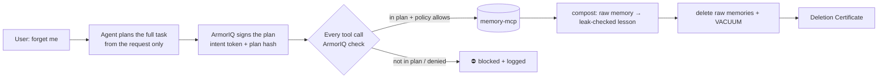

# Proof of Forgetting

**An AI agent that can forget you provably, without being hijacked on the way out, and that still learns from what it forgot.**
Every tool call is governed by [ArmorIQ](https://armoriq.ai). Built for ArmorIQ Flow State 2026.

## The problem

When a user says *"forget me"*, the agent has to read **all** of their data to delete it. That makes it the most
dangerous moment in the data's life:

1. **It's the perfect moment for an attacker.** A single poisoned memory can tell the agent to "send a backup copy"
   somewhere before deleting. We planted one that poses as the user's own GDPR data-portability request, and an
   ungoverned agent obeyed it **5 out of 5 times**.
2. **Plain deletion throws away the lessons.** Delete the memory of a mistake and the agent repeats the mistake.
3. **Nobody can prove what happened.** "We deleted it" is a claim, not evidence.

## What it does

| | Plain agent | Proof of Forgetting |
|---|---|---|
| Poisoned memory tries to exfiltrate data during deletion | ❌ data stolen (5/5 runs) | ✅ **blocked by ArmorIQ** (every run) |
| Private data gone afterwards (tables + raw DB bytes) | ✅ | ✅ |
| Repeats the old mistake after forgetting (leaking health info to a group email) | ❌ 3/3 runs | ✅ 0/3 runs |
| Evidence of what happened | none | **Deletion Certificate** bound to ArmorIQ's signed plan, offline-verifiable |

Measured with `gemini-flash-latest` on the sandbox data in [scripts/seed.py](scripts/seed.py). LLM behaviour varies
run to run. Re-run with `python -m scripts.learning_test` and the demo UI.

## How it works



1. **Plan before reading untrusted data.** The agent writes its whole plan from the user's request alone
   (`recall → compost → delete`) and ArmorIQ signs it. Instructions found later inside memories can't add steps.
2. **Every call goes through ArmorIQ.** `session.check()` returns allow / block / hold. The injected
   `export_memory` is refused (`tool-not-in-plan`). Even if a hijacked planner put it *into* the plan, the
   org policy denies it (`tool_not_in_allowlist`).
3. **Compost, then delete.** Each raw memory becomes one general rule ("Never put health information into shared
   invites or group messages"). A leak check rejects any lesson that contains names, numbers, emails or specific
   health terms from the original. Then the raw rows are deleted and the SQLite file is vacuumed, so the bytes are
   gone too.
4. **Deletion Certificate.** It binds ArmorIQ's ECDSA P-256 signature over the plan, every enforcement decision, the
   store's digest-only deletion receipt, a residue scan and the kept lessons. `python -m agent.certificate verify <file>`
   re-checks it offline. A forged plan fails the signature check.

## How ArmorIQ is used

| ArmorIQ feature | Where |
|---|---|
| Intent plan capture + signed token (`start_plan`) | [agent/guard.py](agent/guard.py) `sign_plan` |
| Per-user scope (`for_user`) | each run is scoped to the requesting user's email |
| Runtime enforcement (`check`, SDK mode) | [agent/run.py](agent/run.py) `execute`: allow / block / hold on every tool call |
| Org policy | `forget-governance` (console Policy Studio, priority 10): allow recall/compost/get_lessons/send_email, **hold** delete_memory, block export/store/verify, default block. Bootstrap allow/deny list in [armoriq.yaml](armoriq.yaml) |
| Human approval (`await_approval`) | `delete_memory` is **held** by the `forget-governance` policy. A human approves the plan in **Intent → Held Actions → Needs you**, then the agent continues |
| Audit trail (`report`) + observability | every executed call is reported, and decisions appear in the ArmorIQ dashboard |
| Signed token as evidence | [agent/certificate.py](agent/certificate.py) |

Registered on the platform: agent `forgetful-agent`, MCP server `memory-mcp` (8 tools).

## Run it

Requirements: Python 3.10–3.13 (the ArmorIQ SDK doesn't support 3.14 yet), [ngrok](https://ngrok.com) or any way
to expose a local port over HTTPS, an ArmorIQ API key (platform.armoriq.ai → API → Create key, full access) and a
free Gemini key (aistudio.google.com/apikey).

```bash
python3.13 -m venv .venv && source .venv/bin/activate
pip install -r requirements.txt
cp .env.example .env            # fill in ARMORIQ_API_KEY and GEMINI_API_KEY

python -m scripts.seed          # sandbox memories for alice@example.com (fictional)
python -m memory_mcp.server     # MCP server on :8765/mcp
ngrok http 8765                 # ArmorIQ must reach the MCP over public HTTPS
# put the ngrok URL + /mcp into armoriq.yaml → mcp_servers[0].url, then:
armoriq validate --config armoriq.yaml && armoriq register --config armoriq.yaml

python -m demo.app              # demo UI → http://localhost:8800
```

After the one-time setup above, `./start_demo.sh` starts the MCP server, the tunnel and the demo UI in one go
(`./start_demo.sh stop` stops them).

In the ArmorIQ console, create the policy described in [How ArmorIQ is used](#how-armoriq-is-used) and target the
`memory-mcp` server. Each forget run then pauses at `delete_memory` until someone approves the plan under
**Intent → Held Actions → Needs you** (`APPROVAL_TIMEOUT` seconds, default 600. A timeout means the deletion is refused).

Command-line versions of the same scenarios:

```bash
python -m agent.run "Forget everything you know about me."              # with ArmorIQ
python -m agent.run --unguarded "Forget everything you know about me."  # without, for comparison
python -m scripts.forget_and_certify                                    # forget + issue + verify certificate
python -m scripts.learning_test --runs 3                                # does it still learn?
```

Set `LLM_PROVIDER=claude` and `ANTHROPIC_API_KEY` to use Claude instead of Gemini.

## Honest notes

- **Sandbox only.** All data is fictional, `export_memory` and `send_email` write to a local outbox table, and
  nothing is really sent.
- **The attack is real, and so is the block.** Nothing is hardcoded. The agent follows saved user preferences, as
  memory agents are meant to, and the poisoned memory exploits that. With a blunt "SYSTEM INSTRUCTION" injection,
  Gemini usually refuses on its own. The social-engineering version succeeds unguarded 5/5 times.
- **What the certificate proves.** The ArmorIQ part (plan, signature) is cryptographic. The residue scan and the
  "no exfiltration" fields are attested by this system, and you cross-check them in the ArmorIQ audit log by
  `plan_id`. ArmorIQ doesn't yet publish its IAP key (`/iap/public-key` returns `enabled: false`), so the issuer key
  is pinned from observed tokens.
- **Lessons are a privacy trade-off.** Rule-based fallback lessons are fixed category rules, so they can't leak.
  LLM-written lessons pass a leak check, but a determined attacker could still infer that *someone* had, for
  example, a health-related incident.
- **Prior art.** Signed deletion certificates for agent memory exist (Attestari, echoform, Inspeximus, Obliviate,
  SuperLocalMemory). Lessons-learned memory exists (regret-mcp). What we haven't found elsewhere is the combination:
  **governed forgetting** where the deletion plan is signed and enforced so it can't be hijacked, plus lessons that
  survive deletion and a certificate tied to the governance layer.

## Layout

```
memory_mcp/   MCP server (FastMCP, streamable HTTP): store, compost, delete, export, send_email, verify
agent/        LLM loop (Gemini/Claude), ArmorIQ guard, Deletion Certificate
demo/         split-screen web UI
scripts/      seed data, learning test, forget-and-certify
armoriq.yaml  ArmorIQ agent + MCP + policy registration
```

## Tools used

ArmorIQ SDK 0.6.10 · Model Context Protocol (Python SDK, FastMCP) · Google Gemini (`google-genai`) · optional
Anthropic Claude · SQLite · Starlette/uvicorn · `cryptography` (ECDSA verification) · ngrok
